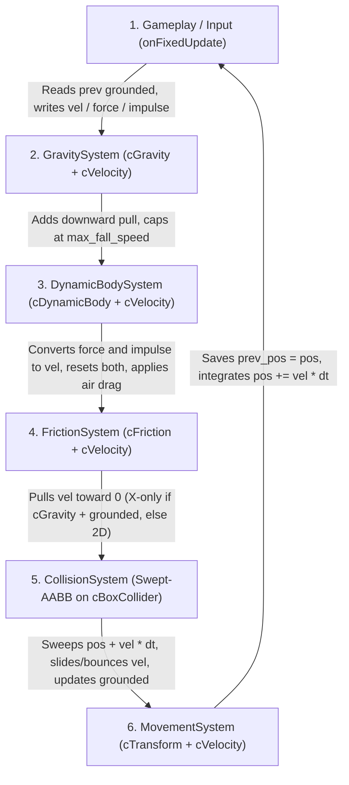

# Lili2D Physics Pipeline

---

## Tick Flow

---

## Step-by-Step Breakdown

### 1. Gameplay / Input

- Reads **`cDynamicBody::grounded`** from the _previous_ tick to decide things like jumping.
- Writes directly to **`cVelocity`** (snappy movement) or adds to **`cDynamicBody::force`** / **`cDynamicBody::impulse`**.

### 2. `GravitySystem` (`cGravity` + `cVelocity`)

- Pulls `vel.y` downward (`+Y` is down) by `force * scale * dt` and caps it at `max_fall_speed`.
- **Runs before `DynamicBodySystem`** so downward impulses (like a dash, ground-pound, or knockback) can still temporarily go faster than `max_fall_speed`.
- Top-down RPG entities simply don't attach [cGravity](file:///home/lili/Documents/VertX/include/lili2d/components/gravity.hpp).

### 3. `DynamicBodySystem` (`cDynamicBody` + `cVelocity`)

- Treats `force` (continuous push) and `impulse` (instant kick) in [cDynamicBody](file:///home/lili/Documents/VertX/include/lili2d/components/dynamic_body.hpp) as temporary inputs:
  - `vel += (force / mass) * dt`
  - `vel += impulse / mass`
  - Resets `force` and `impulse` back to `{0, 0}`.
- Applies `resistance` (air drag) to slow down velocity smoothly.

### 4. `FrictionSystem` (`cFriction` + `cVelocity`)

- Pulls velocity toward `0` using `amount * dt` in [cFriction](file:///home/lili/Documents/VertX/include/lili2d/components/friction.hpp), stopping cleanly at `0` without flipping direction.
- **With `cGravity`:** Only slows `vel.x` when `grounded == true` (never fights falling or air movement).
- **Without `cGravity` (top-down):** Slows the 2D `(x, y)` speed evenly so diagonal movement decelerates smoothly.

### 5. `CollisionSystem` (Swept-AABB on `cTransform` + `cBoxCollider`)

- Resets `grounded = false`, then sweeps each moving box along `vel * dt` against other [cBoxCollider](file:///home/lili/Documents/VertX/include/lili2d/components/box_collider.hpp) boxes.
- **How Swept-AABB works:** Inflates the target box by the moving box's half-size (Minkowski sum), then casts a ray from the moving center along `vel * dt` to find the exact hit fraction `t` in `[0, 1]` and surface `normal`, preventing high-speed tunneling.
- **On solid hit (`physical == true`):**
  - Slides/bounces `cVelocity` along the surface using `bounciness` and `contact_friction`.
  - Sets `grounded = true` when landing on a surface below (`normal.y < 0`).
  - Uses a tiny overlap push-out fallback if two boxes spawned already inside each other.
- **Non-physical (`physical == false`):** Skips blocking so triggers don't stop movement.

### 6. `MovementSystem` (`cTransform` + `cVelocity`)

- Runs last and stays completely pure (easy to run in parallel):
  - `trans.prev_pos = trans.pos;` (ready for `alpha` render interpolation later!)
  - `trans.pos += vel * dt;`

---

## Quick Genre Cheat-Sheet

| Entity Type                    | Components Attached                                                                          |
| :----------------------------- | :------------------------------------------------------------------------------------------- |
| **Static Wall / Floor**        | `cTransform` + `cBoxCollider`                                                                |
| **Trigger Zone**               | `cTransform` + `cBoxCollider` (`physical = false`)                                           |
| **Platformer Player**          | `cTransform` + `cVelocity` + `cGravity` + `cFriction` + `cDynamicBody` + `cBoxCollider`      |
| **Top-Down RPG Character**     | `cTransform` + `cVelocity` + `cFriction` + `cDynamicBody` + `cBoxCollider` _(no `cGravity`)_ |
| **Simple Bullet / Projectile** | `cTransform` + `cVelocity` + `cBoxCollider`                                                  |
